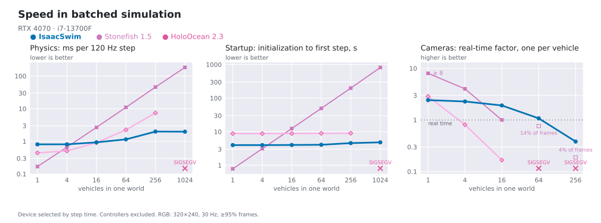
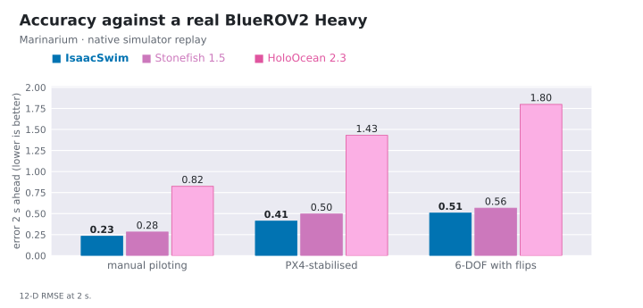

# IsaacSwim: Underwater robotics add-on for NVIDIA Isaac Sim and Isaac Lab.

IsaacSwim adds MuJoCo's hydrodynamics, plus buoyancy, currents, thrusters and marine sensors to any articulation or rigid body. Made for
ROVs, AUVs, underwater manipulation, and swimming robots to run in the Isaac ecosystem. Optional
[OceanSim](https://github.com/umfieldrobotics/OceanSim) integration provides
underwater cameras, sonar and waves.

[](LICENSE)

https://github.com/user-attachments/assets/7d49cbf6-5a34-47af-9ca0-91c8da5710de

*A demo mission made with IsaacSwim's task and scene APIs, at 8× speed.
[Watch at normal speed on YouTube](https://youtu.be/3lMIQrnFJFI).*

## Status

Version 0.1.0 is a research beta for Isaac Sim 5.1 and Isaac Lab 2.3. Isaac Sim 6.2
and Isaac Lab 3.0 are supported as a research preview; see
[installation](docs/installation.md#isaac-sim-6-and-isaac-lab-3).

## Benchmarks

IsaacSwim, Stonefish 1.5 and HoloOcean 2.3 on one RTX 4070 / i7-13700F Linux
machine. Stonefish is faster with one vehicle; IsaacSwim's batched physics
scales better as the fleet grows in this workload. Accuracy uses native
simulator rollouts against recorded BlueROV2 Heavy motion. The
[benchmark methods](docs/benchmarks.md) describe the workloads and protocol.

<picture>
  <source media="(prefers-color-scheme: dark)" srcset="docs/media/bench_speed_dark.svg">
  
</picture>

<picture>
  <source media="(prefers-color-scheme: dark)" srcset="docs/media/bench_accuracy_dark.svg">
  
</picture>

## Capabilities

| Component | |
|---|---|
| Hydrodynamics | MuJoCo's ellipsoid fluid model (drag, lift, added-mass cross terms) with optional acceleration added mass. Torch reference and NVIDIA Warp kernels. |
| Buoyancy | Displaced volume and centre of buoyancy from meshes, clipped at a flat or moving free surface. |
| Ingestion | Fluid shapes read from a robot's geometry the way MuJoCo reads geoms, or from its mass properties, a URDF or a MuJoCo model. |
| Currents | Uniform, gusting, jet, pipe and boundary-layer fields; NetCDF ocean data and CFD point clouds. |
| Actuators | Thruster allocation, propeller and motor models, joint servos. |
| Sensors | Depth, DVL, altimeter, IMU and odometry models; OceanSim camera, sonar, DVL and barometer. |
| Tasks and scenes | A framework for your own tasks and USD scenes, with scripted experts, parallel evaluation, HDF5 demonstrations and example tasks. |

## Install

See [installation](docs/installation.md). In short, with Isaac Lab installed:

```bash
"${ISAACLAB_PATH}/isaaclab.sh" -p -m pip install --no-deps \
    -e source/isaacswim -e source/isaacswim-bench
```

Leave out `source/isaacswim-bench` if you only need the library. Next, run your
[first simulation](docs/first_simulation.md) or [build a task](docs/tasks.md).

## Quick start

Attach water forces to any initialized Isaac Lab articulation:

```python
from isaacswim import Medium
from isaacswim.isaaclab import Hydrodynamics, HydrodynamicsCfg

hydro = Hydrodynamics(HydrodynamicsCfg(auto_shapes=True, medium=Medium.sea_water()),
                      robot)

while simulation_app.is_running():
    hydro.apply()
    robot.write_data_to_sim()
    sim.step()
    robot.update(sim.get_physics_dt())
```

## Documentation

| Guide | |
|---|---|
| [Installation](docs/installation.md) | Isaac Sim, Isaac Lab, optional components |
| [First simulation](docs/first_simulation.md) | The fluid model alone, then in Isaac Sim |
| [Physics model](docs/physics.md) | Equations, conventions and assumptions |
| [Hydrodynamics](docs/hydrodynamics.md) | Fluid shapes, buoyancy and added mass on your robot |
| [Water and currents](docs/environment.md) | Water properties, flow fields, ocean and CFD data |
| [Vehicles](docs/vehicles.md) | The vehicle loop, controllers and trim |
| [Actuators](docs/actuators.md) | Thrusters, propellers, motors and joint servos |
| [Navigation sensors](docs/sensors.md) | Depth, DVL, altimeter, IMU and odometry |
| [Cameras and sonar](docs/sensing.md) | Underwater cameras and OceanSim sensors |
| [OceanSim and ROS 2](docs/ecosystem.md) | Waves, sensor topics, vehicle topics |
| [Porting from MuJoCo](docs/porting_from_mujoco.md) | Moving an underwater MuJoCo model to Isaac Sim |
| [Tasks and scenes](docs/tasks.md) | Build your own tasks and scenes, evaluate and record them |
| [BlueROV2 Heavy](docs/bluerov.md) | The example vehicle and its asset builder |
| [Licensing](docs/licensing.md) | Third-party material and asset terms |

## Limitations

- No wakes, vortex shedding, wave orbital velocity or body-to-body fluid interaction.
- Drag uses ellipsoids; this is not a computational fluid dynamics solver.
- Acceleration added mass assumes full submersion.
- Mesh buoyancy assumes a closed surface; flooded frames need explicit volumes.

## Development

```bash
python -m pip install -e "source/isaacswim[all]" -e "source/isaacswim-bench[all]" pytest ruff
pytest -q
ruff check source scripts
```

See [CONTRIBUTING.md](CONTRIBUTING.md).

## Citation and licence

Cite with [CITATION.cff](CITATION.cff). Source code is Apache-2.0; downloaded
vehicle descriptions and vendor assets keep their own terms, described in
[Licensing](docs/licensing.md) and [NOTICE](NOTICE). IsaacSwim is not affiliated
with NVIDIA, DeepMind, Blue Robotics, Reach Robotics or Robotiq.

The Reach Alpha 5 model is used with Reach Robotics' written authorization, for
simulation only: it is downloaded from a source carrying Reach's license, the
original and converted files must not be redistributed, Reach's notices stay
with them, and the simulated Alpha 5's performance is not representative of the
real product's performance. See [Licensing](docs/licensing.md#reach-alpha-5).
